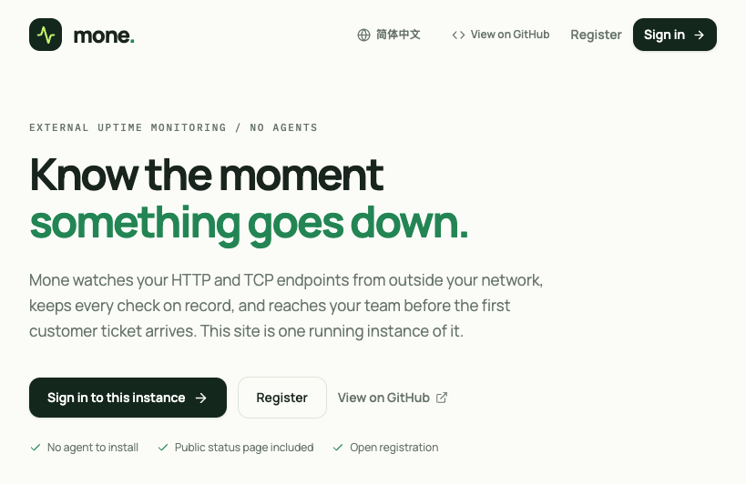

<p align="center">
  
</p>

<p align="center">
  <strong>Lightweight, agentless uptime monitoring.</strong><br>
  HTTP &amp; TCP checks, heartbeat history, incidents, Telegram and Discord alerts, and shareable status pages &mdash; running entirely on Vercel and Supabase.
</p>

<p align="center">
  <a href="https://vercel.com/new/clone?repository-url=https%3A%2F%2Fgithub.com%2Fmahoo12138%2Fmone&project-name=mone&repository-name=mone&env=VITE_SUPABASE_URL,VITE_SUPABASE_ANON_KEY&envDescription=Supabase%20project%20URL%20and%20anon%20key&envLink=https%3A%2F%2Fgithub.com%2Fmahoo12138%2Fmone%23environment-variables">
    
  </a>
</p>

<p align="center">
  <a href="assets/homepage.png"></a>
</p>

Mone watches your endpoints from **outside** your network. There is no agent to install and no server to babysit: a cron job inside Supabase probes every due monitor, records each result, groups failures into timed incidents, and fans alerts out to chat.

## Features

- **HTTP and TCP checks** &mdash; assert a status code, a timeout, or a reachable port. Intervals and failure/success thresholds decide when a run of failures becomes an incident.
- **Heartbeat history** &mdash; every result is stored, so each monitor keeps the bars you need and the response-time chart behind them.
- **Incidents with a start and an end** &mdash; outages are grouped per monitor and timed, then kept as a history you can read once the noise settles.
- **Telegram and Discord alerts** &mdash; route failures into a chat your team already reads. Each channel can be paused independently, and delivery runs through a durable queue rather than a best-effort request.
- **Public status pages** &mdash; publish selected monitors at `/status/:slug`, readable without an account and backed by the same history.
- **Agentless by design** &mdash; checks run outside your infrastructure, so an outage of your own service cannot silence its own alert.
- **Bilingual UI** &mdash; English and 简体中文, switchable in place.

## How it works

1. The Vue single-page app is served from Vercel and signs users in through Supabase Auth.
2. Monitors, check results, incidents, and notification channels live in Supabase Postgres.
3. Supabase Cron calls `run-due-checks` every minute. It leases due monitors, probes them from outside your network, records the results, and enqueues alerts.
4. `send-notifications` drains the queue to each enabled Telegram or Discord channel.
5. `run-data-retention` prunes old data once a day, at 03:15 UTC.

## Tech stack

| Layer | Choice |
| --- | --- |
| Frontend | Vue 3 + TypeScript, Cormi |
| Styling | Tailwind CSS 4, Manrope + IBM Plex Mono |
| Components | reka-ui, Lucide icons |
| Internationalization | vue-i18n (English, 简体中文) |
| Data & auth | Supabase Postgres + Auth |
| Background work | Supabase Edge Functions (Deno) + Cron (pg_cron, pg_net) |
| Hosting | Vercel (static SPA) |

## Getting started

**Prerequisites:** Node.js 20+, pnpm, and &mdash; for the full backend &mdash; the [Supabase CLI](https://supabase.com/docs/guides/cli).

```bash
pnpm install
cp .env.example .env.local   # add your Supabase URL and anon key
pnpm dev                     # http://localhost:8000
```

Running `pnpm dev` without credentials starts in **demo mode**: the workspace fills with clearly labelled sample data, so you can explore the UI before wiring up a backend. This fallback is limited to development; a production build never serves sample data.

### Scripts

| Command | Description |
| --- | --- |
| `pnpm dev` | Start the dev server on port 8000 |
| `pnpm build` | Build the production SPA to `dist/` |
| `pnpm preview` | Preview a production build |
| `pnpm setup` | Generate Cormi's route and entry types |
| `pnpm typecheck` | `cormi setup` + `vue-tsc --noEmit` |

## Environment variables

| Variable | Where | Purpose |
| --- | --- | --- |
| `VITE_SUPABASE_URL` | Frontend build | Your Supabase project URL |
| `VITE_SUPABASE_ANON_KEY` | Frontend build | Supabase anon (publishable) key |
| `RUN_DUE_CHECKS_TOKEN` | Edge Functions + Vault | Shared bearer token the cron jobs use to call the workers |
| `VITE_DEMO_MODE` | Frontend build (optional) | Publish a build that always shows the labelled sample data |

Without `VITE_SUPABASE_URL` and `VITE_SUPABASE_ANON_KEY`, a production build renders a "not configured" screen instead of falling back to sample data.

## Deploy

The **Deploy with Vercel** button above imports this repository, prompts for the two `VITE_*` variables, and builds the frontend. The backend is a Supabase project you own:

1. **Create a Supabase project** and note its project ref.
2. **Link and push the schema:**

   ```bash
   supabase link --project-ref <your-project-ref>
   supabase db push
   ```

3. **Choose one worker token** and store it in the two places it is needed. The same value goes into Vault (read by cron) and into the Edge Function secrets (read by the workers):

   ```sql
   -- Supabase SQL editor
   select vault.create_secret('<long-random-token>', 'mone_run_due_checks_token');
   ```

   ```bash
   supabase secrets set RUN_DUE_CHECKS_TOKEN=<long-random-token>
   ```

4. **Deploy the Edge Functions.** The three cron-facing functions authenticate with the custom bearer token above, so they must skip platform JWT verification. `send-channel-test` is called by signed-in users and keeps JWT verification:

   ```bash
   supabase functions deploy run-due-checks --no-verify-jwt
   supabase functions deploy send-notifications --no-verify-jwt
   supabase functions deploy run-data-retention --no-verify-jwt
   supabase functions deploy send-channel-test
   ```

   > Redeploying a function resets `verify_jwt`, so keep `--no-verify-jwt` on every deploy of the three cron functions.

5. **Point the cron jobs at your project.** The scheduling migrations contain absolute function URLs. Replace the project ref in those migrations with your own before `supabase db push`, or push first and then recreate the `mone-run-due-checks`, `mone-send-notifications`, and `mone-data-retention` jobs against your project.
6. **Set the frontend variables** in your Vercel project (`VITE_SUPABASE_URL`, `VITE_SUPABASE_ANON_KEY`) and redeploy if needed.

## Security

- Probe targets and user-configured notification URLs are SSRF-validated inside the Edge Functions.
- A public status page only exposes the monitors you explicitly publish.
- The browser ships only the Supabase anon key; privileged work runs server-side with the service key and a private worker token.

## Project structure

```text
src/                 Vue app: pages, components, composables, services, i18n
supabase/
  migrations/        schema, metrics, uptime aggregation, scheduling, retention
  functions/         run-due-checks, send-notifications, run-data-retention, send-channel-test
  config.toml        local Supabase configuration
assets/              logo (light/dark) and homepage screenshot
cormi.yml            Cormi app configuration
vercel.json          SPA rewrites and build settings
```
